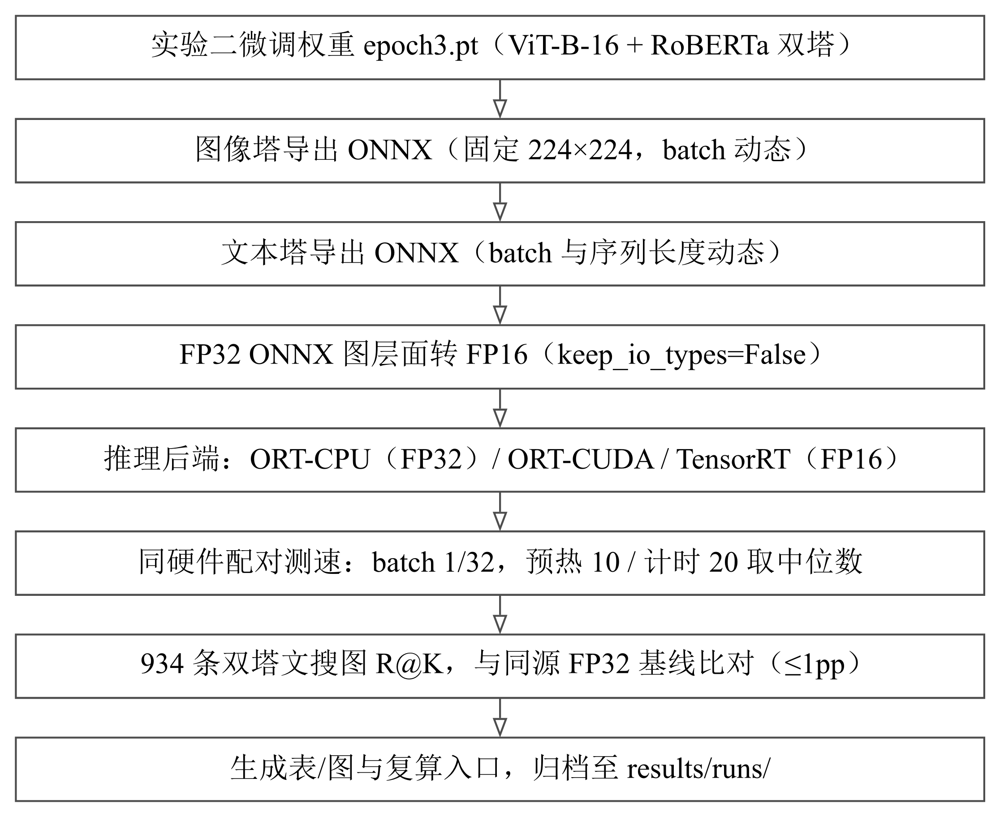

# 实验三交付材料（第23组）· 算法优化实验：推理加速与部署验证

在实验二微调得到的 Chinese-CLIP 双塔权重上，本实验完成 ONNX 导出（图像塔固定 224×224、文本塔 batch 与序列长度动态）、FP32→FP16 图层面转换，接入 ONNX Runtime 的 CPU/CUDA 执行提供器与 TensorRT 后端，在同一训练机上配对测速，并用 934 条文搜图核对精度一致性。**TensorRT-FP16 把图像塔 batch=1 中位延迟从 4.59 ms 降到 1.94 ms（2.366 倍）、batch=32 从 50.43 ms 降到 23.84 ms（2.115 倍）；双塔 R@1 相对同源 FP32 基线净差 −0.4283 个百分点。** 本轮主线是任务书 3.1.4 推理加速，兼顾 3.2.1 计算图优化；量化/剪枝/蒸馏均不在本轮主线。

- 项目仓库：<https://github.com/serendip215-cell/Agent_ShopVision>
- 完整结果目录：`evaluation/retrieval/results/runs/exp3_inference_acceleration_20261025/`（本目录是其交付副本）

## 一、交付清单

| 文件 | 说明 |
|---|---|
| `实验三实验报告 第23组.pdf` | 实验报告正文（19 页） |
| `实验三实验报告 第23组.docx` | 同一份报告的 Word 版（21 页，正文与 PDF 逐字一致，差异仅来自 Word 自带断行。字体按课程模板：章标题宋体 14pt 加粗、封面校名宋体、正文宋体/Times 12pt、代码与行内代码 Consolas 9pt 非斜体；封面的标签右缘与取值中心、三条填空线位置都与 PDF 对齐；编号列表的正文列也与 PDF 对齐；正文里 22 处图/表/代码交叉引用与 12 处文献引用号都是可点击跳转的内部超链接） |
| `README.md` | 本文件：使用方法、特别解释、关键结果、仓库地址 |
| `推理加速流水线图.png` | 报告图 1 的推理加速与双塔 ONNX 部署流水线（450 DPI RGB PNG） |
| `结果图表/` | 9 张中文结果图的 PNG/PDF 与逐图口径 `figure.json`，用法见 `图表说明.md` |
| `测量凭证/` | 派生表格、判定汇总、运行元数据、源输入快照、132 条历史查询复算、逐文件说明 |
| `模型与数据来源说明.txt` | 权重/数据从哪来、为什么 ONNX 与 TensorRT 引擎不随包交付 |

`测量凭证/` 明细：`tables/`（写表用的派生 CSV）、`summary.json`（本轮判定与限制）、`run_metadata.json`（源提交与执行范围）、`inputs/`（源 JSON 与历史查询快照，含 SHA-256 溯源）、`reference_retrieval/`（132 条历史排序复算）、`测试结果说明.md`（逐文件说明）。

## 二、推理加速流水线

实验二微调权重 `epoch3.pt` 经双塔 ONNX 导出与图层面 FP16 转换后，分别接入三种后端，在同硬件配对口径下测速，再在 934 条双塔文搜图上比对 R@K，最后生成表、图与复算入口并归档：



## 三、怎么用（复现本次实验）

**模型侧**（需要 epoch3.pt、ONNX Runtime、TensorRT 的训练机）：按 `docs/流程与交接/实验三杜军博任务交付.md` 第 5.2 节的命令重新导出 ONNX、重建 TensorRT 引擎并测速；首次构建引擎需 5–20 分钟，稳态延迟不含这段冷启动时间。导出脚本的 `export_report_<precision>.json` 会被同一 run 中最后导出的塔覆盖，现场展示时要说明是哪一个塔。

**复算与绘图侧**（只需要 numpy/matplotlib/Pillow，不要求 torch/CUDA/TensorRT；Linux 另需 Noto Sans CJK SC 字体）：

```bash
conda activate pytorch
python -m pip install -r evaluation/retrieval/requirements-report.txt
python evaluation/retrieval/code/evaluate_acceleration.py --run-id exp3_report_my_run
```

PowerShell 入口：`.\evaluation\retrieval\scripts\run_exp3_evaluation.ps1 -RunId exp3_report_my_run`。默认输出到 `evaluation/retrieval/results/runs/<run-id>/`，拒绝无意覆盖已有结果（显式加 `--overwrite` / `-Overwrite`）。

只重绘：`python evaluation/retrieval/code/render_acceleration_charts.py --run-dir <run-dir>`。
从归档快照产生新 run：`python evaluation/retrieval/code/evaluate_acceleration.py --config <run-dir>/inputs/evaluation_config.json --run-id <new-run-id>`。
逻辑测试：`python -m unittest discover -s evaluation/retrieval/tests -p test_acceleration.py -v`（8 项，覆盖配对比值、provider 回退、跨设备与线程不对齐拒绝等）。

## 四、特别的解释（口径红线）

- **速度只覆盖图像塔 forward**，不是完整检索请求的加速；各图/表也不能跨设备换算加速比。
- **同硬件配对**：CPU 要求 PyTorch 与 ONNX Runtime 均为 8 线程；加速比一律取同一文件内的同精度 PyTorch 对照。
- **基线用同源自研 FP32（R@1 = 58.5653）**，不混用实验二官方脚本的 58.67（两者相差约 0.1pp，来自特征传递与 top-k 实现等口径差异）。
- **934 条与 132 条是两套口径**：934 条是精确配对的文搜图测试，132 条是旧索引的 AI 试点标签评测，不能混算，也不能用后者证明本轮 TensorRT 的端到端收益。
- **没有 TRT 分类别结果**：报告图 04 是「后端 × R@K 指标」的误差热力图，图 06 是 9 类别 FP32 基线，不把冻结的 INT8 损失当成 TensorRT 损失。
- **参数与理论 FLOPs 没有减少**：后端优化不改模型结构，42.63 GFLOPs 只统计 MatMul/Conv（batch=1、224×224、文本长度 52）。
- **文本塔 ONNX 体积 389.58/194.97 MiB** 是单塔导出报告，被同一 run 中最后一次导出覆盖，不能当作双塔 ONNX 总量。
- **测速为单轮预热 10 次、计时 20 次的中位数**，没有置信区间；吞吐沿用来源已四舍五入的值。
- **INT8 动态量化是冻结的历史探索**（纯权重压到 313.88 MB，但 R@1 大幅下降），不作为本轮成功结果。

## 五、关键结果

### 图像塔速度（同硬件配对，预热 10/计时 20 取中位数）

| 后端 | batch | PyTorch 中位/ms | 引擎中位/ms | 加速比 | 延迟降低 | 吞吐提升 | 判定 |
|---|---:|---:|---:|---:|---:|---:|:--|
| ORT-CPU（FP32） | 1 | 90.56 | 85.24 | 1.062× | 5.87% | +6.36% | 未达标 |
| ORT-CPU（FP32） | 32 | 2532.61 | 2554.38 | 0.991× | −0.86% | −0.79% | 未达标 |
| ORT-CUDA（FP16） | 1 | 4.98 | 4.54 | 1.097× | 8.84% | +9.81% | 未达标 |
| ORT-CUDA（FP16） | 32 | 50.90 | 54.55 | 0.933× | −7.17% | −6.70% | 未达标 |
| **TensorRT（FP16）** | **1** | **4.59** | **1.94** | **2.366×** | **57.73%** | **+136.58%** | **达标** |
| **TensorRT（FP16）** | **32** | **50.43** | **23.84** | **2.115×** | **52.73%** | **+111.52%** | **达标** |

### 双塔精度一致性（934 条文搜图，候选池 934）

| 后端 | R@1 | R@5 | R@10 | mean_recall | ΔR@1/pp |
|---|---:|---:|---:|---:|---:|
| PyTorch FP32（基线） | 58.5653 | 89.2934 | 96.6809 | 81.5132 | +0.0000 |
| ORT-CPU FP32 | 58.5653 | 89.2934 | 96.6809 | 81.5132 | +0.0000 |
| **TensorRT FP16** | **58.1370** | 89.2934 | 96.5739 | 81.3348 | **−0.4283** |

### 模型规模与文件体积

| 对象 | 参数量 | 理论 FLOPs（batch=1） | 体积 |
|---|---:|---:|---:|
| 图像塔（ViT-B-16） | 86,192,640 | 33.70 G | — |
| 文本塔（RoBERTa） | 102,070,272 | 8.93 G | ONNX FP32 389.58 / FP16 194.97 MiB |
| 合计 | **188,262,912** | **42.63 G** | 纯权重 FP32 718.29 / FP16 359.21 MiB |

### 验收判定（8 项全部通过）

| 任务 | 指标 | 实测 | 阈值 | 判定 |
|---|---|---:|:--:|:--|
| 3.1.4 | 延迟降低 batch=1 | 57.73% | ≥40% | 通过 |
| 3.1.4 | 吞吐提升 batch=1 | +136.58% | ≥50% | 通过 |
| 3.1.4 | 延迟降低 batch=32 | 52.73% | ≥40% | 通过 |
| 3.1.4 | 吞吐提升 batch=32 | +111.52% | ≥50% | 通过 |
| 3.1.4 | 模型级 R@1 绝对差 | 0.4283pp | ≤1pp | 通过 |
| 3.2.1 | 计算图加速比 batch=1 | 2.366× | ≥1.2× | 通过 |
| 3.2.1 | 计算图加速比 batch=32 | 2.115× | ≥1.2× | 通过 |
| 3.2.1 | 模型级 R@1 绝对差 | 0.4283pp | ≤0.5pp | 通过 |

## 六、尚未完成与边界

- **现场演示/录屏未执行**：需要持有训练机与 `epoch3.pt` 的人按第 5.2 节命令执行，本包只提供可照做的步骤，未把预训练权重冒充微调权重。
- **没有 TRT 分类别输出、没有逐样本排名**：因此只能说净命中差约相当于 4 条，不能说“仅 4 条查询发生变化”。
- **不给逐节点 TensorRT 执行比例**：凭证只记录请求 provider 与实际会话 provider 列表。
- 交付文档中的数字一律以 `测量凭证/tables/` 与 `summary.json` 为准，不应手工改写；原始训练机凭证仍保存在仓库 `docs/optimize/runs/`，本目录只是可独立复现的交付副本。