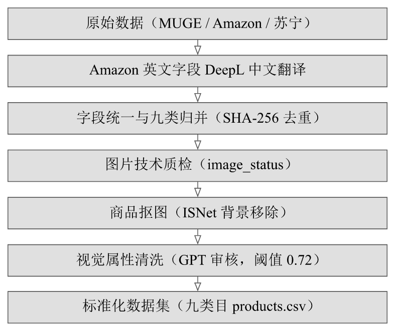
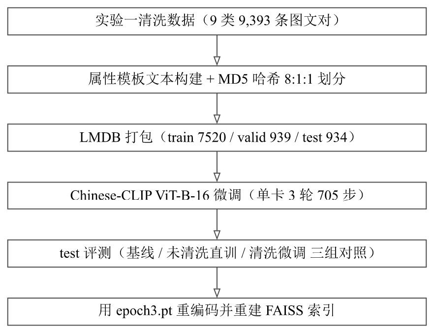
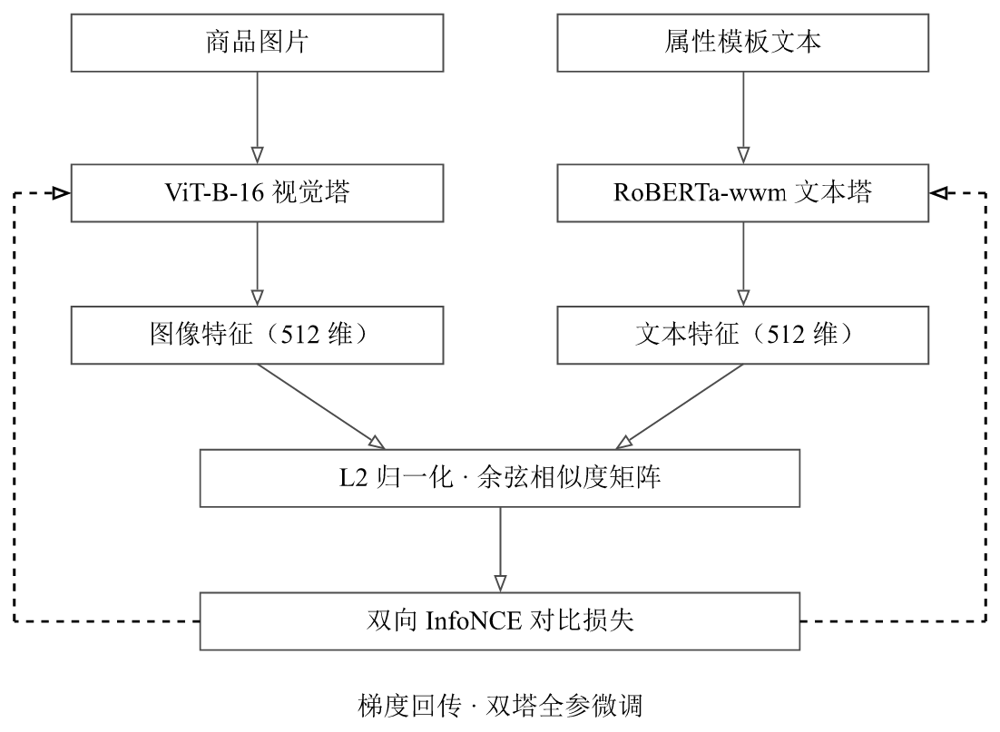

# 实验二交付材料（第23组）· 模型设计与训练

在实验一的数据基座上，本实验完成中文图文检索模型的选型、微调、评测与检索接入。模型为 Chinese-CLIP ViT-B-16 双塔（视觉塔 ViT-B-16 + 文本塔 RoBERTa-wwm-ext-base-chinese），单卡 8GB 微调 3 轮后 test R@1 从 37.37 提升到 **58.67**。

- 项目仓库：<https://github.com/serendip215-cell/Agent_ShopVision>
- 全部代码、报告源文件与训练凭证都在仓库里；报告用 `docs\scripts\build_typ.cmd 实验二` 一条命令编译

## 一、交付清单

| 文件 | 说明 |
|---|---|
| `实验二实验报告 第23组.pdf` | 实验报告正文 |
| `README.md` | 本文件：使用方法、特别解释、项目框架截图、仓库地址 |
| `项目框架截图/` | 项目数据流水线图、微调训练流水线图、模型架构图 |
| `模型与数据下载链接.txt` | 预训练权重、微调权重、数据的下载地址 |
| `训练凭证/` | 两组训练的 test 分数 json、训练日志、超参快照、run_manifest |

> `模型与数据下载链接.txt` 里微调权重的网盘链接交前补上（现在是〈待填〉占位）。

## 二、项目框架

整个项目的数据流水线（实验一完成的部分 → 本次实验的输入）：



本次实验的微调训练流水线：



模型架构（Chinese-CLIP 双塔 + 双向 InfoNCE）：



## 三、怎么用（复现本次实验）

环境：NVIDIA RTX 5060 Ti（8GB 显存），Windows 11 宿主机 + WSL2 + Docker 容器 `pytorch/pytorch:2.7.1-cuda12.8-cudnn9-devel`，Python 3.11。

1. **取数据**：实验一清洗产出的 9 类 9,393 条图文对（`data/processed_data_cleaning/`，见实验一交付材料）。
2. **放权重**：Chinese-CLIP 预训练权重 `clip_cn_vit-b-16.pt`（719MB）放到 `models/chinese_clip/`，下载地址见 txt。
3. **施加补丁**：克隆 Chinese-CLIP 官方代码，按 `docs/finetune/04-Chinese-CLIP补丁说明.md` 施加 3 处本地补丁（含改前改后代码，可逐行核对）。
4. **构建训练数据并打包 LMDB**（约 1.2GB，不入 git，可完全重建，无需下载）：

   ```bash
   python scripts/build_retrieval_dataset.py \
     --input-dir data/processed_data_cleaning \
     --output-dir data/processed_data_retrieval/datasets/ShopVision

   python Chinese-CLIP/cn_clip/preprocess/build_lmdb_dataset.py \
     --data_dir=/workspace/data/processed_data_retrieval/datasets/ShopVision \
     --splits=train,valid,test
   ```

   划分固定为 train 7,520 / valid 939 / test 934（按 item_id 的 MD5 哈希 8:1:1）。

5. **训练**（单卡 3 轮 705 步，约 6 分钟）与 **评测**（约 3 分钟）：

   ```bash
   RUN_ID=2026-10-18_bs32_lr1e-5 DATASET=ShopVision bash scripts/finetune/run_train_single_gpu.sh
   RUN_ID=2026-10-18_bs32_lr1e-5 bash scripts/finetune/run_test_eval.sh
   ```

   容器内如遇 CRLF 问题：`tr -d '\r' < run_train_single_gpu.sh > /tmp/run.sh && bash /tmp/run.sh`。

6. **核对结果**：直接看 `训练凭证/` 里的分数 json 与日志。完整步骤文档在仓库 `docs/finetune/`（01 数据转换 → 02 训练 → 03 结果 → 04 补丁 → 05 对照组）。

## 四、特别的解释

- **NoDDP 补丁**：WSL2 下 NCCL 首次集合通信永久挂死（`init_process_group` 正常），多种环境变量无效。最终用 NoDDP 包装器把 DDP 降级为单卡，保留 `module.` 前缀，官方 `extract_features.py` 导出零修改兼容。3 处补丁全文见 `docs/finetune/04-Chinese-CLIP补丁说明.md`。
- **8GB 显存的取舍**：混合精度 + 梯度检查点，用约 1.5 倍训练时长换 batch 32 稳定运行，避免小 batch 下对比学习负样本不足。
- **属性模板文本**：商品大类/细分类/颜色/材质/标题五段式模板，训练文本与 FAISS 建索引共用同一生成函数 `build_product_text`，统一文本分布并顺带适配非标标题。
- **防泄漏划分**：按 `item_id` 的 MD5 哈希 8:1:1 切分，同一商品永远落在同一划分，杜绝图文泄漏。
- **对照组设计**：两组唯一差异是数据（未清洗 10,165 条 vs 清洗 9,393 条），超参/种子/轮数/批大小完全相同，据此拆出「微调本身 +13.59pp / 数据清洗 +7.71pp」。
- **test 只用一次**：test 划分只做最终评测，调参一律看 valid，防止结论被测试集污染。

## 五、关键结果（test 934 条）

| 模型 | R@1 | R@5 | R@10 | mean_recall |
|---|---:|---:|---:|---:|
| 预训练零样本基线 | 37.37 | 70.77 | 82.44 | 63.53 |
| 未清洗数据直训 | 50.96 | 84.48 | 93.04 | 76.16 |
| 清洗数据微调（最终） | **58.67** | **89.08** | **96.90** | **81.55** |

拆分：微调本身 +13.59pp（约 64%），数据清洗 +7.71pp（约 36%）；总 +21.30pp、相对 +57.0%。
