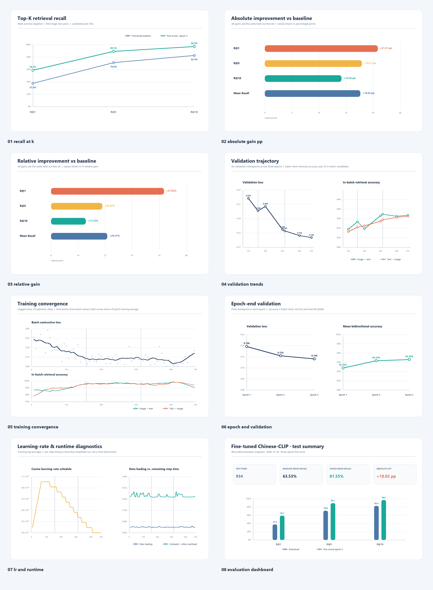

# 微调后 Chinese-CLIP 测试集评估

## 评估结果

本目录归档 `2026-10-18_bs32_lr1e-5` 微调实验在固定测试集上的模型级图文检索评估。使用官方 `cn_clip/eval/` 流程比较 Chinese-CLIP 预训练基线与 Epoch 3 微调权重，任务为文本检索图像（Text-to-Image），Top-K 最大为 10。

| 指标 | 预训练基线 | 微调 Epoch 3 | 绝对提升 |
|---|---:|---:|---:|
| R@1 | 37.37% | 58.67% | +21.31 个百分点 |
| R@5 | 70.77% | 89.08% | +18.31 个百分点 |
| R@10 | 82.44% | 96.90% | +14.45 个百分点 |
| Mean Recall | 63.53% | 81.55% | +18.02 个百分点 |

微调模型在这组固定测试集上的召回指标均高于预训练基线；R@1 和 Mean Recall 提升明显。R@10 已接近饱和，后续模型比较应重点看 R@1 和 Mean Recall，并补充真实用户自然语言查询的独立评测。

## 图表位置

所有图表和重绘脚本直接放在本目录根部，图表总览如下：



| 文件 | 内容 |
|---|---|
| `00_contact_sheet.png` | 全部图表总览 |
| `01_recall_at_k.png` | R@1、R@5、R@10 对比 |
| `02_absolute_gain_pp.png` | 绝对百分点提升 |
| `03_relative_gain.png` | 相对基线的提升比例 |
| `04_validation_trends.png` | 验证损失及双向批内准确率趋势 |
| `05_training_convergence.png` | 训练损失与批内准确率走势 |
| `06_epoch_end_validation.png` | 每轮末验证结果 |
| `07_lr_and_runtime.png` | 学习率与训练耗时诊断 |
| `08_evaluation_dashboard.png` | 测试指标总览仪表盘 |

在本目录运行 `python .\render_eval_charts.py` 可根据本目录的归档分数和训练日志重绘图表；依赖 `numpy`、`Pillow`。训练曲线里的双向准确率是 32 个 batch 内候选的准确率，不等于 934 候选上的完整测试 Recall@K。

## 测试口径与限制

- 测试图文样本数为 934，候选池也是 934；不能与官方 MUGE 十万级候选池的 Recall@K 直接比较。
- 测试文本与训练数据采用相同的属性模板，指标可能高估对自由形式用户查询的表现。该测试集已用于最终评估，不应继续用于超参数选择。
- 本目录的指标是 2026-10-18 已完成评估的归档结果。本次只整理文件和重绘图表，没有重新加载权重或运行推理评估。正式数值以 `baseline_test_score.json`、`finetuned_epoch3_test_score.json` 和 `summary.json` 为准。
- 这是 checkpoint 级模型评估，不是 AI 复核的端到端商品索引评测。因此没有 `ai_review.csv`、`query_audit.csv`、`ranked_results.csv`、`query_metrics.csv` 或逐查询商品联系表；不要将这些指标与同目录下的查询/qrels 实验混算。

## 文件目录

```text
finetuned_epoch3_test_20261019/
├─ inputs/
│  ├─ params_2026-10-18-12-27-38.txt
│  └─ README.md
├─ baseline_test_score.json
├─ finetuned_epoch3_test_score.json
├─ run_manifest.json
├─ summary.json
├─ out_2026-10-18-12-27-38.log
├─ 00_contact_sheet.png
├─ 01_recall_at_k.png ... 08_evaluation_dashboard.png
├─ render_eval_charts.py
└─ 测试结果说明.md
```

`contact_sheets/` 在此评估中不适用：源脚本只输出汇总指标，没有逐条查询和 Top-K 商品图。测试输入的来源及未随结果归档的原因见 [`inputs/README.md`](inputs/README.md)。`run_manifest.json` 中的 `/workspace/...` 是原 Docker 容器路径，仅用于追溯原运行环境。
